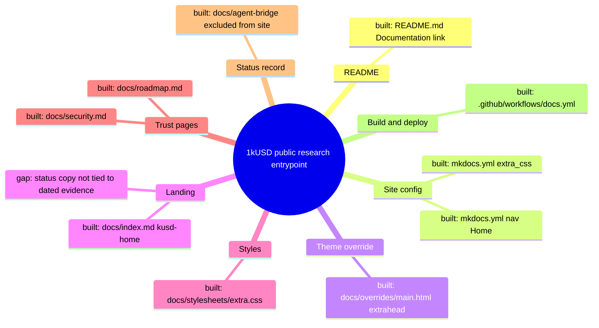

# Architecture map — public documentation path

Scope: **one hop only** — the public documentation entrypoint. This map covers
how a visitor reaches the project status. It does not map contracts, the dApp,
backends, or the Kaspa design. Mapped on 2026-10-10 for ticket `T-019`
(landing/README refresh under issue #131).

## 1. Core idea

- 1kUSD is a public research program for a fully collateralized, USD-targeting
  stablecoin. Kaspa is the primary target and the Solidity code is an
  executable EVM reference (`docs-internal/adr/ADR-041-kaspa-primary-product-track.md`).
- The public site and README must give visitors the dated research status,
  the intended mechanism, and the security and contribution channels
  (`README.md`, `docs/index.md`).
- Boundary: the site documents. It deploys nothing and holds no keys, wallet,
  oracle, or runtime state (`mkdocs.yml`, `.github/workflows/docs.yml`).

## 2. Path (hop list)

| # | From | To | What crosses the edge |
|---|---|---|---|
| 1 | `README.md::Documentation` | `https://neabouli.github.io/1kUSD/` | visitor link to the public site |
| 2 | `mkdocs.yml::nav.Home` | `docs/index.md` | landing page source |
| 3 | `mkdocs.yml::theme.custom_dir` | `docs/overrides/main.html::extrahead` | meta, Open Graph, JSON-LD on top of Material `base.html` |
| 4 | `mkdocs.yml::extra_css` | `docs/stylesheets/extra.css::.kusd-home` | brand tokens and landing layout |
| 5 | `docs/index.md` CTAs | `how-it-works.md`, `security.md`, `roadmap.md`, `whitepaper/`, `community.md`, GitHub | visitor navigation |
| 6 | `.github/workflows/docs.yml::build` | `deploy` (GitHub Pages) | `mkdocs build --strict` artifact `site/` |

## 3. Modules

| Module | One job | Entry | State |
| --- | --- | --- | --- |
| README | GitHub entrypoint and status summary | `README.md` | built |
| Site config | title, navigation, theme, CSS wiring | `mkdocs.yml::nav` | built |
| Theme override | head metadata on Material | `docs/overrides/main.html::extrahead` | built |
| Landing | project entrypoint page | `docs/index.md::.kusd-home` | built — status copy drifted |
| Styles | brand tokens, responsive landing | `docs/stylesheets/extra.css` | built |
| Trust pages | security limits, roadmap | `docs/security.md`, `docs/roadmap.md` | built — undated wording |
| Mechanism pages | intended model | `docs/how-it-works.md`, `docs/what-is-1kusd.md` | built — out of scope |
| Status record | dated bridge state, ticket index | `docs/agent-bridge/` (excluded from the site) | built |
| Build/deploy | strict build and Pages deploy | `.github/workflows/docs.yml` | built — unchanged neighbor |
| Watchdog | minimal docs presence check | `docs/scripts/scan_docs.sh` | built |

## 4. Wiring

- `README.md` links visitors to the deployed site URL.
- `mkdocs.yml` maps the `Home` tab to `docs/index.md`.
- `mkdocs.yml` points Material to `docs/overrides/`, whose `main.html` extends `base.html`.
- `mkdocs.yml` loads `docs/stylesheets/extra.css`, which styles `.kusd-home`.
- `docs/index.md` links to the mechanism, security, roadmap, whitepaper, and community pages and to GitHub.
- `.github/workflows/docs.yml` builds `site/` strictly and deploys it to Pages on `main`.

## 5. Contradictions and gaps

- **Undated counters:** the landing showed `229` tests as a live fact. It is a
  historical result (#124, 2026-08-16) with eight placeholders.
- **Status drift:** the bridge status (`docs/agent-bridge/`) is excluded from
  the site, so the landing copy was not tied to its dated entries.
- **Kaspa wording:** the README described the Toccata stack as "live". Public
  pages must not infer network activation from documentation or testnet facts.
  The ADR-042 revalidation (#131) is still in review.
- **Toolchain versions:** CI pins `mkdocs-material==9.6.20`. Local previews may
  use a newer version.

## 6. Diagram files

- `docs/architecture/map.puml` — mind map and component diagram
- `docs/architecture/main-path.puml` — visitor sequence for the same path

PlantUML was not installed when this map was written, so no SVGs were
rendered. The Mermaid mind map above is the renderable fallback.

## 7. Next step

- **Module:** Landing, plus the README and trust pages.
- **Hop:** 2, 4, and 5 (`mkdocs.yml::nav.Home` → `docs/index.md` → CTAs).
- **Change:** dated copy and navigation in `README.md`, `docs/index.md`,
  `docs/roadmap.md`, `docs/security.md`, `docs/stylesheets/extra.css`, and the
  `mkdocs.yml` title/navigation.
- **Untouched:** `docs/overrides/main.html`, `.github/workflows/*`, contracts,
  the dApp, the whitepapers, the mechanism pages, and every ADR.
